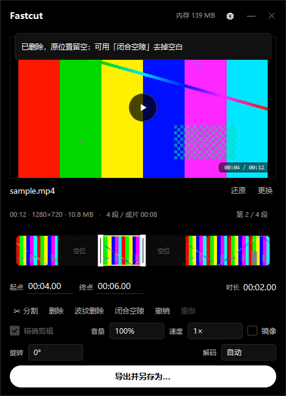

# Fastcut 快剪

屏幕右上角常驻的轻量视频快剪工具。点一下悬浮球，把视频拖进来，切段、删块、导出另存为。

**Developed by VMOStar**

## 快速开始

**直接双击 `Fastcut.exe`，屏幕右上角出现黑色悬浮球。

## 主要功能

| 功能 | 说明 |
| --- | --- |
| 快速分割 | `S` 键或双击时间轴，播放头处一切为二 |
| 删除 / 波纹删除 | `Delete` 留空位，`Shift+Delete` 后段自动前移 |
| 闭合空隙 | 一键把所有片段按顺序靠拢，去掉空白 |
| 磁吸拖动 | 拖片段或边缘时自动吸附到邻近边界、播放头、起点 |
| 精确剪辑 | 可选逐帧重编码，或流复制秒切（单段无特效时） |
| 旋转 / 镜像 / 变速 / 音量 | 预览与导出同步生效 |
| 代理预览 | 遇到解不了的格式自动生成 720p 代理，导出仍用原片 |
| 开机自启 | 设置 → 常规 → 勾选「开机自动启动」 |

### 快捷键

| 键 | 作用 |
| --- | --- |
| `空格` | 播放 / 暂停（自动跳过空位） |
| `←` / `→` | 逐帧步进（`Shift` 为 1 秒） |
| `S` | 在播放位置分割 |
| `Delete` | 删除选中片段（留空） |
| `Shift+Delete` | 波纹删除（后面片段前移） |
| `Ctrl+Z` / `Ctrl+Y` | 撤销 / 重做 |
| `I` / `O` | 用播放位置设入点 / 出点 |
| `Esc` | 收回悬浮球 |

## 设置

点标题栏 ⚙ 打开设置（也可从托盘右键菜单进入），分五页：

| 页 | 设置项 |
| --- | --- |
| 常规 | 关闭面板时的动作、开机自启、悬浮球停靠四角、悬浮球大小 |
| 播放 | 解码方式（自动 / 硬解 D3D11 / 软解）、循环播放、时间轴缩略图开关 |
| 存储 | 缓存目录、日志目录，支持浏览 / 打开 / 清空缓存 |
| 导出 | 默认画质（CRF 18/20/23）、默认格式、默认目录、完成后打开文件夹 |
| 关于 | 版本、内存占用、配置目录、日志路径 |

缓存和日志目录默认在系统临时目录 / 程序目录下，可随时改到空间更大的盘。

## 关闭与托盘

点标题栏 ✕ 时按设置里的「关闭面板时」执行：

- **询问**：弹窗选择「隐藏到托盘」或「退出」
- **隐藏到任务栏托盘**：面板消失，程序后台运行，托盘图标可唤回
- **直接退出**：完全退出

## 支持格式

MP4 / MOV / MKV / AVI / WEBM / M4V / FLV / TS / WMV / MPG 等。

## 系统要求

- Windows 10 / 11（64 位）
- 内存：悬浮球待机约 68 MB，预览 720p 视频约 148 MB
- 不需要管理员权限（普通用户即可运行）

---

## 界面设计

当前采用 **真黑扁平（True Black Flat）** 风格：

- **底色** `#000000`，层级只靠明度差，无渐变、无发光、无投影
- **强调色** `#C6F24E` 柠檬绿，只出现在时间轴数据上
- **悬浮球** 纯黑底 + 白色描边，hover 时描边变亮

**展开/收缩动画**：点击悬浮球后，黑色圆角遮罩从球的位置以 `OutCubic` 曲线展开为面板（350ms），内容淡入；收起时面板先淡出，遮罩再收缩回球体（250ms）。
